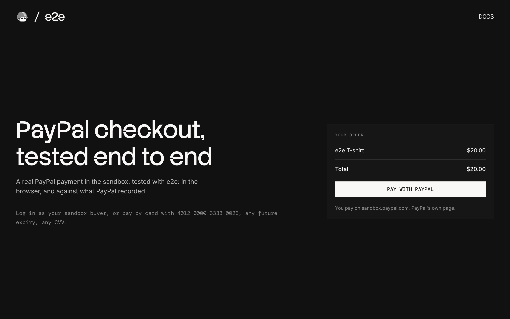

# e2e-paypal

A checkout that takes real PayPal payments in the PayPal sandbox, used as an example of end-to-end testing a payment page you don't own with [e2e](https://www.npmjs.com/package/e2e).



## How it works

The shopper leaves for PayPal's own checkout page, pays there, and comes back:

- **Checkout** (`app/page.tsx`) shows the order and a Pay with PayPal button.
- **`POST /checkout`** (`app/checkout/route.ts`) creates a PayPal order and redirects to PayPal's checkout page on `sandbox.paypal.com`.
- **`GET /capture`** (`app/capture/route.ts`) is where PayPal sends the shopper back after they approve. It takes the payment.
- **Return page** (`app/return/page.tsx`) asks PayPal for the order and shows the result. When PayPal refuses the payment, it offers another way to pay.

The amount comes from the server, and the return page checks with PayPal instead of trusting the URL. There is no PayPal script in the browser, no popup window, and no database: the PayPal order is the only state.

### Paying in the sandbox

| How                                                                         | Result   |
| --------------------------------------------------------------------------- | -------- |
| Log in as your sandbox buyer and complete the purchase                      | Paid     |
| Pay with Debit or Credit Card: `4012 0000 3333 0026`                        | Paid     |
| Pay with Debit or Credit Card: the same card, first name `CCREJECT-REFUSED` | Declined |

For the card, use any future expiry date, any CVV, and any US billing address.

## Getting started

```bash
npm install
npm run dev
```

Open [http://localhost:3000](http://localhost:3000).

### PayPal sandbox

Everything runs in the free PayPal sandbox. Log in at [developer.paypal.com](https://developer.paypal.com) with any PayPal account, then:

1. Under **Testing Tools → Sandbox Accounts**, create a US business account (the shop) and a US personal account (the buyer).
2. Under **Apps & Credentials → Sandbox**, create an app linked to the US business account.
3. Copy `.env.example` to `.env.local` and set:
   - `PAYPAL_CLIENT_ID` and `PAYPAL_CLIENT_SECRET`: the app's client ID and secret.
   - `PAYPAL_BUYER_EMAIL` and `PAYPAL_BUYER_PASSWORD`: the personal account's login, for the tests. Put a password with `#` or `$` in single quotes, or it gets cut short.

## End-to-end tests

The tests in `tests/redirect.e2e.ts` pay on PayPal's real page: the sandbox buyer logs in and pays, a guest pays with a card the bank refuses, and the shopper backs out. They combine exact locators on our pages with `agent.act` / `agent.assert` steps on PayPal's pages, then check what PayPal recorded through its API.

- The buyer's password is an e2e credential: the agent fills it in without ever seeing it. e2e stops taking screenshots once it is filled, so that test checks PayPal's page with vision before logging in.
- PayPal's pages change from run to run (the login, the guest card form, and where a refused card is declined: on PayPal's page, or when we take the payment). The agent adapts, the declined-card test accepts both outcomes, and every test runs up to two more times before it counts as failed.

The agent model goes through the Vercel AI Gateway, so set `AI_GATEWAY_API_KEY` (or link a Vercel project). Then, with the dev server running:

```bash
npm run test:e2e
```

To watch the browser, run `npm exec -- e2e run --headed`. To test a different URL, set `APP_URL`. Configuration lives in `e2e.config.ts`.

## Scripts

| Command            | Description          |
| ------------------ | -------------------- |
| `npm run dev`      | Start the dev server |
| `npm run build`    | Build for production |
| `npm run lint`     | Run ESLint           |
| `npm run format`   | Format with Prettier |
| `npm run test:e2e` | Run the e2e tests    |
